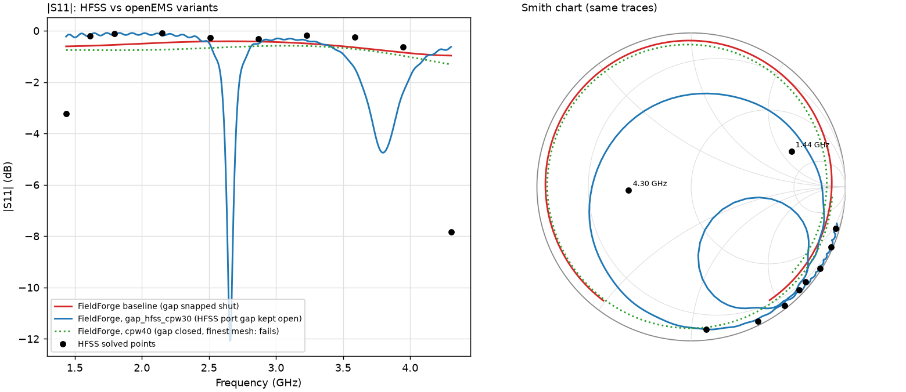

# Ring antenna: why FieldForge (openEMS) and Ansys HFSS disagree

Attribution record, 2026-10-31. Method: physkit `attribute-mechanism`: pin the signature as numbers,
list every candidate, change one knob per candidate, keep what reproduces the signature, then try to
falsify what survives. No solver code was changed for this analysis; every variant is a knob in
`run_variant.py` applied to the imported project `ring_import.ffproj`.

**Result (grade: PROVISIONAL, survived one falsification attempt).** The main disagreement comes from
the **port's lower terminal**:
- In the HFSS model the lumped-port sheet (x = 87.4573 mm) stops **43 µm short of the ground plane**
  (which starts at x = 87.5 mm), so the port is not galvanically connected to ground.
- FieldForge merges mesh lines closer than a tenth of a cell (0.17 mm here), which **silently closes
  that gap**.
- The two solvers are therefore simulating different circuits:
  - HFSS: an open-circuited port that couples to the antenna through a small gap capacitance;
  - FieldForge: a port connected straight into the 23 mm tapered feed.

What remains unexplained is listed at the end. Neither solver is mesh-converged.



## 1. Signature (the numbers any explanation must reproduce)

HFSS data, extracted from the raw `.aedtresults` folder by `extract_hfss.py` (`hfss_extracted.json`):

- The interpolating sweep did **not** converge (`ExtrapolationIsConverged=false`, interpolation basis
  of 1). Only **10 frequencies** were actually solved out of the 401 requested, spaced 0.36 GHz apart.
- The adaptive mesh did **not** converge either:
  - ΔS by pass: 0.44, 0.27, 0.13, 0.081 at passes 2–5, against a 0.05 target;
  - the final mesh has 12,911 tets (16,155 including background), adapted only at 2.87 GHz;
  - the minimum mesh edge is 0.115 mm, larger than the 43 µm gap.

| f (GHz) | HFSS S11 | HFSS dB | FieldForge baseline S11 | FF dB | \|ΔS11\| |
|---|---|---|---|---|---|
| 1.435 | +0.650+0.230j | −3.23 | −0.568−0.738j | −0.62 | 1.56 |
| 1.614 | +0.938−0.271j | −0.21 | −0.752−0.555j | −0.58 | 1.71 |
| 2.152 | +0.835−0.530j | −0.10 | −0.929+0.186j | −0.47 | 1.90 |
| 2.870 | +0.742−0.615j | −0.32 | −0.231+0.925j | −0.42 | 1.82 |
| 3.587 | +0.432−0.872j | −0.24 | +0.789+0.489j | −0.65 | 1.41 |
| 4.305 | −0.405−0.021j | −7.84 | +0.500−0.738j | −1.00 | 1.16 |

The pinned signature:
- **|S11| alone hides the disagreement.** Both solvers show no resonance from 1.6 to 3.9 GHz
  (|S11| between −0.1 and −0.6 dB).
- **The phase is where they differ.**
  - HFSS: S11 stays near the open-circuit point, Z ≈ (3–8) − j(55–350) Ω. That is a series
    capacitance of **0.43 pF at 2.15 GHz**, with only **68°** of phase rotation over 1.61–3.95 GHz.
  - FieldForge baseline: Z goes through a series resonance near 2.0 GHz, with **226°** of rotation.
    That is the signature of a port driving a transmission line into the disc's capacitance to
    ground (about 3.5 pF: 154 mm² over 1.65 mm of εr = 4.3).
- **The band edges differ too:** HFSS gives −3.2 dB at 1.435 GHz and −7.8 dB at 4.305 GHz.

Metric used below: the mean complex distance |S11,FF − S11,HFSS| over the 8 interior HFSS points.
The baseline scores 1.67 on it. For scale, HFSS's own last pass-to-pass change was 0.08.

## 2. Candidates, one knob each, and verdicts

| # | Candidate mechanism | Knob (run) | Interior distance | Verdict |
|---|---|---|---|---|
| C0 | Extraction artifact (my parsing of the HFSS files) | Re-read both adaptive solutions (SOL399, SOL400) independently; both give S11(2.87 GHz) = 0.742−0.615j; parts and IDs in HFSS's `bodyFaceInfo.info` match the import | — | **Ruled out** for the 10 solved points. The user's HFSS plot may show the unconverged interpolation between them |
| C1 | **Port–ground gap closed by FieldForge mesh merging** | `gap` = 0.043 (HFSS value), 0.2, 0.5, 1.0 mm | **0.37–0.47** (0.76 for the under-resolved 43 µm run at 20 cells/λ) | **Survives** |
| C2 | FieldForge mesh too coarse | `cpw` = 30, 40 (gap closed) | 1.36, 1.29 | **Ruled out** as the cause of the disagreement: refining moves FieldForge but not toward HFSS. It is a real secondary error (see §4) |
| C3 | Absorbing boundary / region too small | `pad` = 80 mm (vs HFSS's 40 mm) | 1.67 (S11 unchanged to 3 decimals) | **Ruled out** |
| C4 | FDTD time truncation | `ec` = −50 dB | 1.67 (unchanged) | **Ruled out** for the baseline (low Q) |
| C5 | Dielectric loss model (FDTD constant κ vs HFSS constant tan δ) | `tand` = 0 | 1.71 | **Ruled out** for the phase. It sets the mid-band \|S11\| level (−0.55 → −0.09 dB; HFSS −0.26 dB) |
| C6 | Zero-thickness-sheet slab trick | `slab` = 0.1 (half thickness) | 1.72 | **Ruled out** |
| C7 | Copper loss (HFSS finite σ vs FieldForge PEC) | not swept; bounded by C5: removing all dielectric loss changes the distance by only 0.04 | — | **Ruled out** for the phase (conductor loss is much smaller than FR4 loss at tan δ = 0.025) |
| C8 | HFSS not converged | Can't re-run HFSS here. Bounded by its own ΔS = 0.081 at the last recorded pass, and the 0.115 mm minimum edge doesn't resolve the 43 µm gap | — | **Open.** Probably explains part of the 0.37 residual and the band-edge points |
| C9 | Antenna outline rebuilt from HFSS's stored face vertices (the original body is Parasolid) | Not swept. Outline checked visually; arcs recovered; bounding box consistent with the stored geometry | — | **Open (low)** |

The full numbers for every run are in `variants_table.md` and `runs/*/meta.json`; the raw S11 is in
`runs/*/s11.npz`.

## 3. Checking the survivor

- **Minimal-model check.** HFSS's impedance fits a series capacitor in the middle of the band
  (C_eq = 0.28–0.73 pF, rising toward a series resonance near 4.3 GHz). A gap in series with the
  ~3.5 pF disc capacitance gives exactly that. A connected port cannot: with the gap closed,
  FieldForge has no capacitance in series at that point at any mesh density.
- **Scaling with gap size.** If C1 is right, the series capacitance should fall steadily as the gap
  widens, and HFSS's value should land at a physically sensible effective gap. Observed: C_eq =
  0.68, 0.31, 0.19, 0.15 pF for gaps of 0.043, 0.2, 0.5 and 1.0 mm (20 cells/λ). HFSS's 0.43 pF
  corresponds to an effective gap of about 0.1 mm, close to HFSS's own 0.115 mm minimum edge. That is
  consistent with HFSS not resolving the 43 µm gap.
- **Falsification attempt (passed): mesh refinement.** A coincidental match should fall apart when
  the FieldForge mesh is refined. Instead, the exact HFSS geometry (43 µm gap) moved *closer*:
  - distance 0.76 → 0.37 going from 20 to 30 cells/λ;
  - C_eq 0.68 → 0.50 pF, against HFSS's 0.43.
  The two groups never overlap: gap open, 0.37–0.47 (0.76 for the one under-resolved run); gap
  closed, 1.29–1.72, at every resolution and every other knob.
- **Why the grade is PROVISIONAL, not CONFIRMED.** The decisive control hasn't been run yet. It is
  cheap on the HFSS machine and makes a sharp prediction: **move the port sheet to x = 87.5 mm so it
  touches the ground plane, and HFSS should switch to the connected-port behaviour** (a series
  resonance near 2 GHz and 200–300° of phase rotation, like FieldForge with the gap closed).
  Repeating the comparison with an FEM solver here (Elmer/Palace) after its mesh resolves the gap
  would also count.

## 4. Unexplained, and secondary errors found along the way

- **Residual interior distance of 0.37** with the gap open. Both solvers contribute:
  - FieldForge with the gap open changes by 0.70 (43 µm gap) and 0.36 (0.2 mm gap) between 20 and 30
    cells/λ;
  - HFSS's last ΔS was 0.08, on a mesh that doesn't resolve the gap.
- **With the gap open, FieldForge predicts a narrow resonance whose frequency isn't converged.**
  - 43 µm gap: 3.32 GHz at 20 cells/λ, 2.66 GHz (−12 dB) at 30 cells/λ.
  - 0.2 mm gap: 3.51 GHz (−10 dB) at 20 cells/λ, 3.91 GHz (−35 dB) at 30 cells/λ.
  - These resonances are narrower than HFSS's 0.36 GHz sample spacing, so **HFSS's 10-point sweep
    could have missed such a resonance completely.** The 30 cells/λ, 43 µm run also shows small
    ripples, a sign of incomplete ring-down at the −40 dB stop for that high-Q case.
- **HFSS's band-edge points (−3.2 dB at 1.435 GHz, −7.8 dB at 4.305 GHz) aren't reproduced by any
  knob** (distance ≥ 0.4 at 1.435 GHz and ≥ 1.09 at 4.305 GHz). The likely cause is the HFSS mesh,
  which was adapted only at 2.87 GHz and wasn't converged even there. That's untested.
- **FieldForge isn't mesh-converged at its default 20 cells/λ** for this geometry, even with the gap
  closed: mean |ΔS| of 0.96 from 20 to 30 cells/λ, then 0.52 from 30 to 40. The adaptive
  convergence loop on the `openems-validation` branch addresses exactly this.

## 5. Consequences for the tools

**Update, same day: items 1 and 2 are implemented in FieldForge's openEMS path** (as a backup to the
Elmer-side fix).

> **Correction.** An earlier version of this section claimed the fix cut the interior distance to HFSS
> from 1.667 to 0.729. **That was wrong.** The run was broken: the port carried no current, and
> |S11| = 1.000 at every frequency. 0.729 is simply the distance from HFSS's points to the trivial
> open-circuit point S11 = +1. A ring simulation run in the GUI showed the same flat 0 dB.

**What was broken, and how it was found.** Short diagnostic runs (`tools/port_diag.py`) tested
whether port current flows:

| run | port mesh line | port current |
|---|---|---|
| fix as first pushed | x = 87.457**3001**, 0.1 µm inside the antenna's edge | 4e-16 (dead) |
| same, line moved 0.2 µm | x = 87.457**2999**, outside the edge | flows |
| old merging (gap closed) | exactly 87.4573 | flows |

The 0.1 µm offsets were not real geometry. OpenCascade's `BRepBndLib.Add` pads every bounding box by
the shape tolerance (1e-7). The protected mesh lines, and the importer's port corners, inherited that
padding. A mesh line a hair inside a metal sheet's edge disables the openEMS lumped port.

**What is in FieldForge now:**
- **Topology guard.** `solver.small_gaps()` finds conductor/port pairs closer than the line-merge
  tolerance that don't touch (bounding-box filter, confirmed with the exact OpenCascade distance). One
  facing mesh line on each side of the gap is protected, along the axis with the largest separation.
- **Exact bounds.** `geometry.bounds()` uses `BRepBndLib.AddOptimal`, with no tolerance padding.
- **Port connectivity check.** `solver.port_connectivity()` finds floating port terminals. They are
  reported at import, in Validation Check and in the solver log.
- **Dead-port check.** If the excited port's |S11| equals 1 to within 1e-6 at every frequency, the
  solver warns that no current flowed and the results are not meaningful.
- **Far field.**
  - The NF2FF phase centre is now the model centre. It had been the coordinate origin, about 100 mm
    outside the recording box, which openEMS doesn't allow and which distorted the pattern.
  - The 3D pattern is drawn around the model.
  - Efficiency is shown as n/a when the port accepts less than 1 % of the power.

**Verified result on the ring** (normal solver, default 20 cells/λ, 400k cells, 43 µm smallest cell,
about 5 min):
- The port now works: peak port current 1.3e-5, |S11| between 0.715 and 0.998, 13.8 % of the power
  accepted at 2.87 GHz, peak directivity 5.2 dBi, efficiency 6.6 %.
- **1.6–2.5 GHz: agrees with HFSS** (|ΔS11| 0.25–0.34). FieldForge now reproduces HFSS's near-open,
  capacitive port, which supports the port-gap attribution.
- **2.87–4.3 GHz: still disagrees** (|ΔS11| 0.84–1.56). FieldForge has a resonance at 3.33 GHz
  (−2.9 dB) that HFSS's points don't show. This resonance is not mesh-converged: the same geometry at
  30 cells/λ put it at 2.66 GHz (§4). HFSS's 10 points, 0.36 GHz apart, on an unconverged sweep could
  miss it entirely.
- **The single-number metric can't show this.** The interior distance (0.740) is no better than the
  trivial S11 = +1 (0.729), because it is dominated by the upper band. Compare point by point instead
  (table below).

| f (GHz) | HFSS S11 | FieldForge (fixed) S11 | \|ΔS11\| |
|---|---|---|---|
| 1.614 | +0.938−0.271j | +0.840−0.523j | 0.27 |
| 1.794 | +0.907−0.389j | +0.782−0.602j | 0.25 |
| 2.152 | +0.835−0.530j | +0.652−0.733j | 0.27 |
| 2.511 | +0.701−0.669j | +0.428−0.869j | 0.34 |
| 2.870 | +0.742−0.615j | −0.038−0.928j | 0.84 |
| 3.229 | +0.607−0.770j | −0.760−0.012j | 1.56 |
| 3.587 | +0.432−0.872j | +0.724+0.457j | 1.36 |
| 3.946 | +0.100−0.925j | +0.899−0.282j | 1.03 |

**Still needed before the two can agree:**
- A mesh-converged FieldForge run: 30/40 cells/λ with the gap resolved (25–60 min each), or the
  adaptive loop from `openems-validation`.
- A converged HFSS run: ΔS < 0.02, a discrete sweep around 2.5–4 GHz, and ideally the port-touching-
  ground control from §3.

Original list:

1. **The FieldForge mesher must not change topology.** Merging lines closer than max_res/10 can close
   (or open) a gap between conductors. Any gap between a port and a conductor needs its own mesh
   lines, or a warning at import time ("port does not touch a conductor: 43 µm gap").
2. **The importer should validate port connectivity** against the reconstructed geometry and report it.
3. **The HFSS reference should be re-run** with a port that touches the ground, a converged adaptive
   mesh, and a discrete or fully converged sweep, before it is used as ground truth.
4. Results should be reported with a convergence check: FieldForge at 20/30/40 cells/λ, HFSS until
   ΔS < 0.02.

## What would reopen this

- HFSS with the port touching the ground still shows open-circuit behaviour: C1 is falsified.
- A converged FEM run (HFSS or Elmer/Palace) on the HFSS geometry agrees with closed-gap FieldForge.

## Reproduce

```
python extract_hfss.py "<...>/ring_antenna_v1.aedtresults/HFSSDesign1.results" hfss_extracted.json
python run_variant.py ring_import.ffproj runs gap_hfss gap=0.0427      # one variant (~30 s to 30 min)
python analyze.py                                                     # table + attribution.png
```
`ring_import.ffproj` references `ring_antenna_v1.aedt` (not committed). Place it at the path in the
file's `source.path`, or re-import it.
