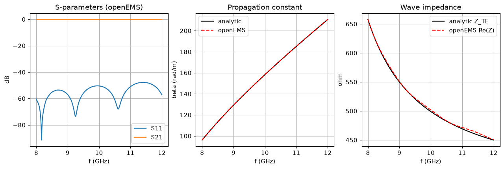
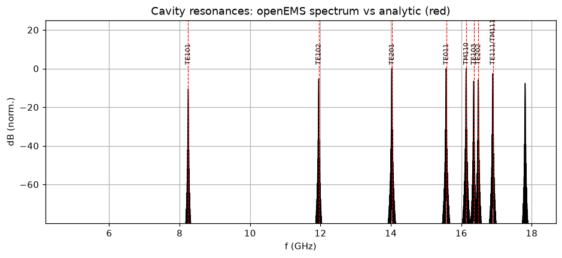
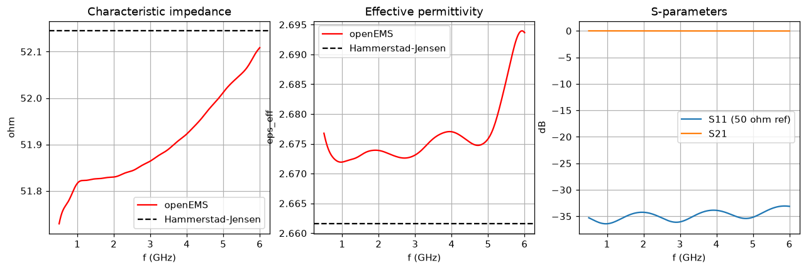
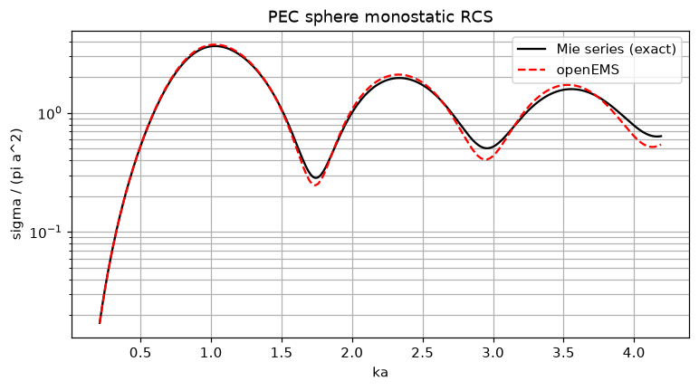
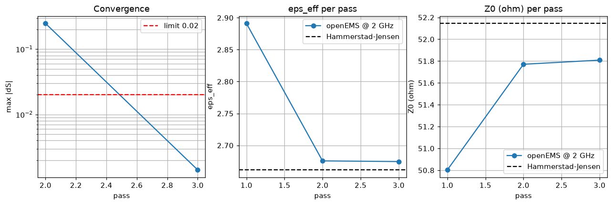
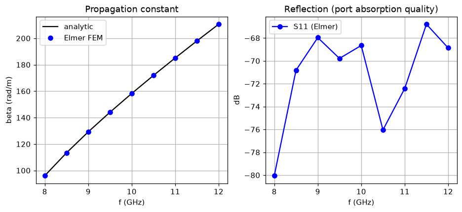

# openEMS validation summary

Generated 2026-10-31 by `run_all.py` — openEMS 0.37.0, Python 3.14.3, Windows 11

| Case | Solver | Result | Runtime |
|---|---|---|---|
| `wr90_waveguide` | openEMS | PASS | 9 s |
| `cavity_eigenmode` | openEMS | PASS | 45 s |
| `microstrip_line` | openEMS | PASS | 91 s |
| `pec_sphere_rcs` | openEMS | **FAIL** | 176 s |
| `microstrip_adaptive` | openEMS | PASS | 186 s |
| `elmer_cavity_eigenmode` | Elmer | PASS | 1 s |
| `elmer_wr90_waveguide` | Elmer | PASS | 61 s |

## `wr90_waveguide` — WR-90 straight guide, TE10, 8-12 GHz

HFSS equivalent: Driven Modal, 2 wave ports, interpolating sweep 8-12 GHz

| Metric | openEMS | Reference | Source | Error | Tolerance | |
|---|---|---|---|---|---|---|
| TE10 cutoff frequency | 6.55 GHz | 6.5571 | analytic | -0.108 % | ±0.5 % | ok |
| beta @ 10 GHz | 158.35 rad/m | 158.24 | analytic | +0.070 % | ±0.5 % | ok |
| wave impedance @ 10 GHz | 501.85 ohm | 498.97 | analytic | +0.575 % | ±1 % | ok |
| min |S21| over band | -0.00032109 dB | 0 | analytic | -0.000321 dB | ±0.1 dB | ok |
| max |S11| over band | -47.727 dB | -30 | analytic | -17.7 dB | <= -30 | ok |

- max |S11|: an ideal matched guide has S11 -> -inf; treated as an upper limit of -30 dB.
- no HFSS reference supplied (references/hfss/wr90_waveguide.csv); compared to analytic only

## `cavity_eigenmode` — PEC cavity 22.86 x 10.16 x 30.0 mm, modes 5-17.5 GHz

HFSS equivalent: Eigenmode solver, PEC boundaries, N modes

| Metric | openEMS | Reference | Source | Error | Tolerance | |
|---|---|---|---|---|---|---|
| f(TE101) | 8.2433 GHz | 8.2439 | analytic | -0.006 % | ±0.5 % | ok |
| f(TE102) | 11.95 GHz | 11.952 | analytic | -0.017 % | ±0.5 % | ok |
| f(TE201) | 14.028 GHz | 14.034 | analytic | -0.040 % | ±0.5 % | ok |
| f(TE011) | 15.569 GHz | 15.577 | analytic | -0.049 % | ±0.5 % | ok |
| f(TM110) | 16.138 GHz | 16.145 | analytic | -0.042 % | ±0.5 % | ok |
| f(TE103) | 16.353 GHz | 16.361 | analytic | -0.050 % | ±0.5 % | ok |
| f(TE202) | 16.484 GHz | 16.488 | analytic | -0.026 % | ±0.5 % | ok |
| f(TE111/TM111) | 16.895 GHz | 16.901 | analytic | -0.033 % | ±0.5 % | ok |

- 81 spectral peaks found; NaN = mode not detected within 1% (T_sim = 143 ns, resolution ~7 MHz)
- no HFSS reference supplied (references/hfss/cavity_eigenmode.csv); compared to analytic only

## `microstrip_line` — Microstrip w=1.1 mm on h=0.508 mm RO4003C (er=3.38)

HFSS equivalent: Driven Terminal, 2 wave ports, sweep 0.5-6 GHz (port Zo, gamma)

| Metric | openEMS | Reference | Source | Error | Tolerance | |
|---|---|---|---|---|---|---|
| Z0 @ 2 GHz | 51.83 ohm | 52.145 | analytic | -0.605 % | ±2 % | ok |
| eps_eff @ 2 GHz | 2.6739 - | 2.6616 | analytic | +0.463 % | ±2 % | ok |
| min |S21| 0.5-6 GHz (lossless) | -0.027477 dB | 0 | analytic | -0.0275 dB | ±0.2 dB | ok |

- Reference is Hammerstad-Jensen (zero strip thickness, quasi-static).
- no HFSS reference supplied (references/hfss/microstrip_line.csv); compared to analytic only

## `pec_sphere_rcs` — PEC sphere a=200 mm, monostatic RCS, ka 0.21-4.19

HFSS equivalent: Driven Modal, incident plane wave, monostatic RCS far-field sweep

| Metric | openEMS | Reference | Source | Error | Tolerance | |
|---|---|---|---|---|---|---|
| RCS/(pi a^2) @ ka=0.5 | -2.6355 dB | -2.6614 | analytic | +0.0259 dB | ±0.5 dB | ok |
| RCS/(pi a^2) @ ka=1 | 5.7427 dB | 5.6161 | analytic | +0.127 dB | ±0.5 dB | ok |
| RCS/(pi a^2) @ ka=2 | 0.11827 dB | -0.14021 | analytic | +0.258 dB | ±0.5 dB | ok |
| RCS/(pi a^2) @ ka=3 | -3.6398 dB | -2.8503 | analytic | -0.79 dB | ±0.5 dB | **FAIL** |
| RMS error, ka 0.3-4.2 | 0.39536 dB | 0.5 | analytic | -0.105 dB | <= 0.5 | ok |

- FDTD cell = lambda/25 at 1 GHz, 6 mm around sphere; staircased sphere
- no HFSS reference supplied (references/hfss/pec_sphere_rcs.csv); compared to analytic only

## `microstrip_adaptive` — Adaptive mesh loop (max|dS| < 0.02) on the case-3 microstrip, from the tutorial mesh

HFSS equivalent: Adaptive passes with Maximum Delta S = 0.02, Minimum Converged Passes = 1

| Metric | openEMS | Reference | Source | Error | Tolerance | |
|---|---|---|---|---|---|---|
| final max|dS| between passes | 0.0014183 - | 0.02 | hfss-criterion | -0.0186 - | <= 0.02 | ok |
| converged Z0 @ 2 GHz | 51.809 ohm | 52.145 | analytic | -0.645 % | ±2 % | ok |
| converged eps_eff @ 2 GHz | 2.6747 - | 2.6616 | analytic | +0.493 % | ±2 % | ok |

- max|dS| 0.0014 < 0.02 for 1 consecutive pass(es)
- pass 1: scale 1.000, 173,907 cells, 52s, max|dS| -, Z0 50.80 ohm, eps_eff 2.8911
- pass 2: scale 1.250, 284,394 cells, 44s, max|dS| 0.2470, Z0 51.77 ohm, eps_eff 2.6757
- pass 3: scale 1.562, 592,900 cells, 91s, max|dS| 0.0014, Z0 51.81 ohm, eps_eff 2.6747
- no HFSS reference supplied (references/hfss/microstrip_adaptive.csv); compared to analytic only

## `elmer_cavity_eigenmode` — PEC cavity 22.86 x 10.16 x 30.0 mm, FEM eigenmodes (Elmer, 2nd-order edge elements)

HFSS equivalent: Eigenmode solver, PEC boundaries, N modes

| Metric | Elmer | Reference | Source | Error | Tolerance | |
|---|---|---|---|---|---|---|
| f(TE101) | 8.2439 GHz | 8.2439 | analytic | +0.001 % | ±0.5 % | ok |
| f(TE102) | 11.952 GHz | 11.952 | analytic | +0.001 % | ±0.5 % | ok |
| f(TE201) | 14.035 GHz | 14.034 | analytic | +0.005 % | ±0.5 % | ok |
| f(TE011) | 15.578 GHz | 15.577 | analytic | +0.009 % | ±0.5 % | ok |
| f(TM110) | 16.147 GHz | 16.145 | analytic | +0.009 % | ±0.5 % | ok |
| f(TE103) | 16.363 GHz | 16.361 | analytic | +0.009 % | ±0.5 % | ok |
| f(TE202) | 16.489 GHz | 16.488 | analytic | +0.008 % | ±0.5 % | ok |
| f(TE111/TM111) | 16.902 GHz | 16.901 | analytic | +0.008 % | ±0.5 % | ok |

- 2,558 tetrahedra (h = 2.5 mm); eigenfrequencies found (GHz): 8.2439, 11.9525, 14.0345, 15.5781, 16.1465, 16.3626, 16.4891, 16.9019, 16.9025, 17.8224
- no HFSS reference supplied (references/hfss/elmer_cavity_eigenmode.csv); compared to analytic only

## `elmer_wr90_waveguide` — WR-90 straight guide, TE10, 8-12 GHz, FEM frequency domain (Elmer)

HFSS equivalent: Driven Modal, 2 wave ports, discrete sweep 8-12 GHz

| Metric | Elmer | Reference | Source | Error | Tolerance | |
|---|---|---|---|---|---|---|
| TE10 cutoff frequency | 6.5586 GHz | 6.5571 | analytic | +0.022 % | ±0.5 % | ok |
| beta @ 10 GHz | 158.22 rad/m | 158.24 | analytic | -0.014 % | ±0.5 % | ok |
| max |S11| over band | -66.793 dB | -30 | analytic | -36.8 dB | <= -30 | ok |

- 4,811 tetrahedra (h = 3 mm), 2nd-order edge elements, 9 frequencies
- fit residual max 2.10e-02; cross-polar |Ex,Ez|/|E| max 4.53e-03; incident amplitude |A| 1.006-1.027 (1.0 expected from the port load)
- no HFSS reference supplied (references/hfss/elmer_wr90_waveguide.csv); compared to analytic only
